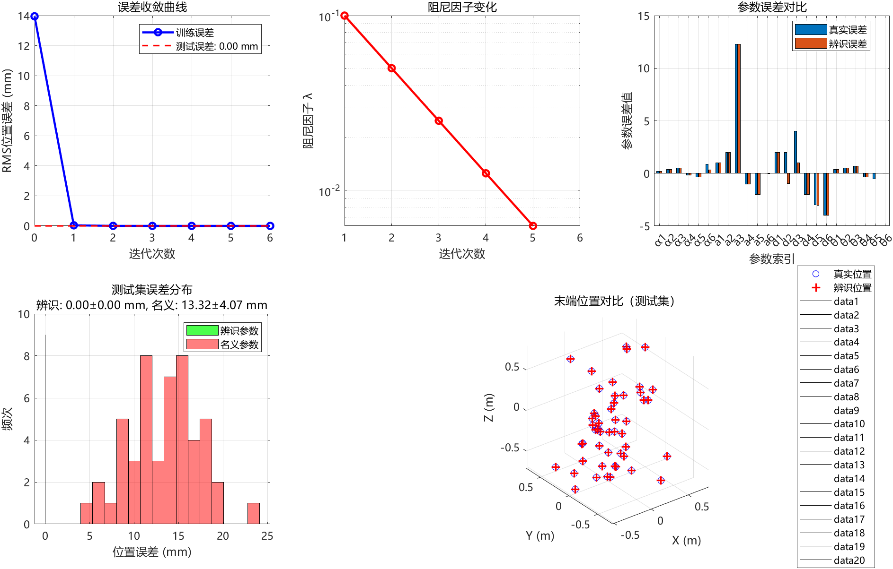
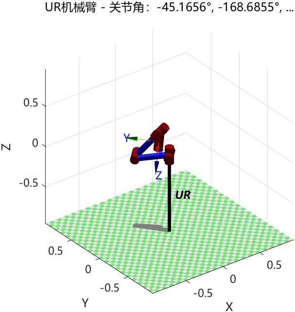
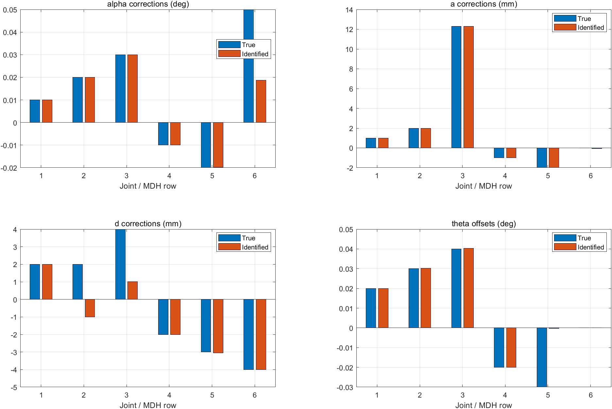
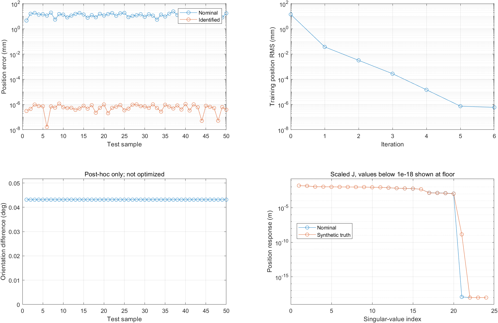

# 六轴机械臂 MDH 参数辨识：原始仿真原型

本仓库保留最初的六轴机械臂 MDH 参数辨识项目。原版利用已知参数偏差生成末端位置，再通过中心差分雅可比和简化 Levenberg–Marquardt（LM）迭代拟合 24 个参数修正，最后用另一组随机关节角检查位置预测。

**本仓库记录的是无噪声数值仿真。位置残差很小，并不表示 24 个参数均恢复真值，也不代表实机达到相同精度。**

2026-10-18 已在本地 MATLAB R2024a 实际运行原版，保存日志、完整数值工作区、CSV、PNG、可编辑 FIG 和补充诊断。本次原有 21 个文件保持逐字节不变；新增的导出工具不修正原版算法。`main.m` 开头虽写有“改进版”，这里仍按最初上传的源文件运行。

## 1. 本次运行结果

运行标签：`run_2026-10-18_seed42`；随机数设置：`rng(42,'twister')`；训练 100 组、测试 50 组；位置噪声保持原版的关闭状态。

| 指标 | 本次结果 |
|---|---:|
| MATLAB | 24.1.0.2537033（R2024a） |
| 原版迭代次数 | 6 |
| 初始训练位置 RMS | 13.9544121 mm |
| 最终训练位置 RMS | 5.93447413e-7 mm |
| 名义模型测试平均位置误差 | 13.3155365 mm |
| 辨识模型测试平均位置误差 | 6.11287245e-7 mm |
| 辨识模型测试位置 RMS（补充计算） | 6.71946630e-7 mm |
| 辨识模型测试最大位置误差 | 1.17160194e-6 mm |
| 测试姿态最大差异（事后诊断） | 0.0431480564° |
| 名义模型位置参数雅可比秩 | 20 / 24 |
| 本次仿真真值处位置参数雅可比秩 | 21 / 24 |

姿态差异与雅可比秩属于运行后的诊断，**没有参与原版优化**。秩检查采用原始 SI 单位雅可比、绝对阈值 `1e-10`；数值秩也应结合参数尺度和奇异值谱解释。

极小的位置误差来自相同运动学模型生成和拟合的无噪声数据，不能解释为真实设备的测量分辨率或定位能力。原版文本中的 `0.000 mm` 是打印舍入，不是误差严格为零。精确数值见 [metrics.json](results/run_2026-10-18_seed42/metrics.json)。

### 1.1 原版生成的两张图

下图为原版自身的结果汇总，保留其原有图例、坐标和统计口径。

原版使用名义参数绘制第一组关节角对应的机器人：

### 1.2 按物理单位分组的参数对比

补充图把角度与长度分开，避免原版把弧度与米放在同一数轴上。可以直接看到：位置拟合接近零时，部分参数仍明显不同于设定真值。

| 参数修正 | 真值 | 本次辨识值 | 单位 |
|---|---:|---:|---|
| δd₂ | +2.000000 | −0.999863 | mm |
| δd₃ | +4.000000 | +1.000136 | mm |
| δα₆ | +0.050000 | +0.018677 | ° |
| δa₆ | 0 | −0.053176 | mm |
| δθ₅ | −0.030000 | −0.000325 | ° |
| δθ₆ | 0 | 0 | ° |

全部 24 项及带符号偏差见 [parameter_comparison.csv](results/run_2026-10-18_seed42/data/parameter_comparison.csv)。最后一项相等不代表第六轴零位被辨识：这个参数对当前被测点的位置没有影响，原版恰好把其真值与初值都设成零。

## 2. 环境与复现

### 2.1 依赖

- 本次验证环境是 Windows、MATLAB R2024a。
- 原版直接使用 Peter Corke 的 [Robotics Toolbox for MATLAB](https://github.com/petercorke/robotics-toolbox-matlab) 中的 `Link`、`SerialLink`，并使用其空间变换类。请按该项目的安装说明配置所需依赖。
- 这组 `Link/SerialLink` 接口不等同于 MathWorks Robotics System Toolbox 的接口。可以用 `which Link`、`which SerialLink` 检查路径。
- 原版通过反斜杠求解线性方程，不调用 Optimization Toolbox。
- 新增导出工具使用 `exportgraphics` 等接口，已在 R2024a 验证，未承诺其他版本的完整兼容性。

### 2.2 推荐运行方式：独立输出目录

在本仓库根目录执行：

~~~matlab
addpath('tools');
outputDir = run_original_simulation(42);
~~~

工具会创建新的运行目录，再执行原版源码的逐字节副本。为复现本次设置，可指定一个**尚不存在**的目录名：

~~~matlab
addpath('tools');
outputDir = run_original_simulation(42,'my_seed42_run');
~~~

本次已提交的目录名为 `run_2026-10-18_seed42`；工具拒绝覆盖已有运行目录。

工具只负责：

1. 设置随机种子及无窗口绘图方式，将原版 `main.m`、`transformation_mdh.m` 复制到独立执行目录。
2. 在基础工作区执行原版 `main`。其中的模型、差分步长、LM 更新、接受条件和停止条件不作改动。
3. 导出原版日志、结果、测试集及图片，再进行独立的参数可辨识性和姿态诊断。

原版入口依然是 [main.m](main.m)。直接在根目录运行 `main` 会将两个同名结果文件写入根目录；使用上述工具可以保留根目录的历史结果。本次固定种子在工具中设置，未取消原版中 `rng(42)` 那行的注释。`clear` 不会把此处已设置的随机数状态重置。

浮点运算、工具箱和绘图版本差异可能改变最后几位数或图像外观。已保存的 MAT/CSV 是本次运行数据的直接记录。

## 3. 文件与运行产物

~~~text
.
├── main.m                         原版完整仿真脚本和局部辅助函数
├── transformation_mdh.m           原版单关节 MDH 变换
├── 其余原始 .m / .mat / .txt       保留的初始项目文件
├── tools/
│   ├── run_original_simulation.m   原版运行、导出及事后诊断
│   └── render_original_diagnostics.m  从已有数据重绘补充图
└── results/run_2026-10-18_seed42/
    ├── console.log                原版控制台输出与导出摘要
    ├── metrics.json               高精度数值指标
    ├── source_manifest.json        原始文件与源码副本的 SHA-256
    ├── artifacts_manifest.json     本次产物的 SHA-256 与大小
    ├── execution/                 实际执行的两份原版源码副本
    ├── original_outputs/          原脚本生成的 MAT 与 TXT
    ├── data/                      数值工作区、训练/测试/参数/迭代 CSV
    ├── diagnostics/               事后雅可比、奇异值、姿态诊断
    └── figures/                   两张原图与两张补充图的 PNG、FIG
~~~

主要数据入口：

- [数值工作区 workspace.mat](results/run_2026-10-18_seed42/data/workspace.mat)：名义参数、真实偏差、辨识偏差、训练与测试关节角、位置及迭代记录；不包含外部工具箱对象。
- [训练数据 train_samples.csv](results/run_2026-10-18_seed42/data/train_samples.csv)：`q1_rad…q6_rad`、`x_m/y_m/z_m`。
- [测试数据 test_samples.csv](results/run_2026-10-18_seed42/data/test_samples.csv)：关节角、真实/辨识位置、名义/辨识位置误差和事后姿态误差。
- [迭代数据 iteration_history.csv](results/run_2026-10-18_seed42/data/iteration_history.csv)：位置 RMS 和原版记录的阻尼。第 0 行无阻尼记录；末行的零值反映原版提前退出时未填历史的缺陷。
- [原版 MAT](results/run_2026-10-18_seed42/original_outputs/mdh_identification_results.mat)、[原版 TXT](results/run_2026-10-18_seed42/original_outputs/identification_results.txt)、[控制台日志](results/run_2026-10-18_seed42/console.log)。

根目录的 `identified_mdh_params.mat`、`mdh_identification_results.mat`、`identification_results.txt` 是初始项目携带的历史文件，**不是这次运行结果**。旧 POE、IK/FK 辅助函数也保留，但 `main.m` 的这条辨识流程主要调用自身局部函数与 `transformation_mdh.m`。

## 4. 模型、参数与仿真数据

### 4.1 MDH 约定

对第 j 行参数，代码使用：

$$
A_j=R_x(\alpha_j)\,T_x(a_j)\,
R_z(q_j+\theta_{0j})\,T_z(d_j).
$$

这里的行索引遵循源代码；在常见 Craig 记号中，代码中的 α、a 通常对应 α 的 j−1 项和 a 的 j−1 项，不能混用索引或标准 DH 变换顺序。

令 φⱼ=qⱼ+θ₀ⱼ，变换展开为：

$$
A_j=
\begin{bmatrix}
\cos\phi_j&-\sin\phi_j&0&a_j\\
\sin\phi_j\cos\alpha_j&\cos\phi_j\cos\alpha_j&-\sin\alpha_j&-d_j\sin\alpha_j\\
\sin\phi_j\sin\alpha_j&\cos\phi_j\sin\alpha_j&\cos\alpha_j&d_j\cos\alpha_j\\
0&0&0&1
\end{bmatrix}.
$$

六节连乘得到法兰变换：

$$
T(q,p)=A_1A_2\cdots A_6=
\begin{bmatrix}R(q,p)&x(q,p)\\0&1\end{bmatrix}.
$$

原版取最后一列的前三项，测量的是**法兰原点**；没有额外工具点或测量坐标系变换。

### 4.2 名义参数

| 行 j | α / ° | a / m | d / m | θ₀ / ° |
|---|---:|---:|---:|---:|
| 1 | 0 | 0 | 0 | 0 |
| 2 | 90 | 0 | 0 | 0 |
| 3 | 180 | 0.38 | 0.0607 | 180 |
| 4 | −90 | 0 | −0.408 | 0 |
| 5 | 90 | 0 | 0 | 0 |
| 6 | 90 | 0 | 0.10667 | 0 |

这些是源代码中的示例参数。机器人名称 `UR` 和代码注释不能作为它对应某款商业 UR 型号的依据。

原版的修正向量顺序为：

$$
\delta p=
[\delta\alpha_1,\ldots,\delta\alpha_6,\,
\delta a_1,\ldots,\delta a_6,\,
\delta d_1,\ldots,\delta d_6,\,
\delta\theta_1,\ldots,\delta\theta_6]^\mathsf T.
$$

运算时 α、θ 为弧度，a、d 为米；表格和图中再转换成度、毫米。自定义 `transformation_mdh` 的 `sigma=1` 表示转动关节，这个标记约定不要与其他工具箱直接混用。

### 4.3 设定的真实参数偏差

| 行 j | δα / ° | δa / mm | δd / mm | δθ / ° |
|---|---:|---:|---:|---:|
| 1 | 0.01 | 1 | 2 | 0.02 |
| 2 | 0.02 | 2 | 2 | 0.03 |
| 3 | 0.03 | 12.3 | 4 | 0.04 |
| 4 | −0.01 | −1 | −2 | −0.02 |
| 5 | −0.02 | −2 | −3 | −0.03 |
| 6 | 0.05 | 0 | −4 | 0 |

对每组随机角度：

$$
q_i\sim U([-\pi,\pi]^6),\qquad
y_i=x(q_i,p_0+\delta p_{\rm true}).
$$

训练 N=100；测试另取 50 组角度。原版的高斯噪声语句被注释，因此当前 y 不是实际传感器数据。两个集合使用不同角度，但由同一运动学实现产生。

## 5. 参数辨识思路与公式推导

### 5.1 从预测误差建立目标函数

名义参数 p₀ 已知，待求的是固定修正 δp。第 i 个姿态的残差：

$$
e_i(\delta p)=x(q_i,p_0+\delta p)-y_i\in\mathbb R^3.
$$

按每组 xyz 的顺序堆叠：

$$
e(\delta p)=[e_1^\mathsf T,\ldots,e_N^\mathsf T]^\mathsf T
\in\mathbb R^{3N}.
$$

最小二乘目标：

$$
F(\delta p)=\frac12 e(\delta p)^\mathsf T e(\delta p).
$$

代码显示的训练 RMS 为：

$$
E_{\rm train}=\frac{\|e\|_2}{\sqrt N}
=\sqrt{\frac1N\sum_i\|e_i\|_2^2}.
$$

这是三维位置距离的 RMS，不是除以 √(3N) 的逐坐标 RMS。原版测试打印的是距离的平均值、最大值和标准差，与训练 RMS 不是同一指标。

### 5.2 参数雅可比

$$
J=\frac{\partial e}{\partial\delta p}\in\mathbb R^{3N\times24}.
$$

每一列描述某个固定参数改变时，全部姿态的预测位置如何变化。它与通常用于速度控制的关节雅可比 ∂x/∂q 不同。

如果参数属于第 j 节，可以按乘积求导：

$$
\frac{\partial T}{\partial p_k}
=A_1\cdots A_{j-1}
\frac{\partial A_j}{\partial p_k}
A_{j+1}\cdots A_6.
$$

再将该导数作用于法兰原点齐次坐标 [0,0,0,1]ᵀ，取前三项，得到位置导数。

**原版实际没有使用这套解析导数**，而是使用中心差分：

$$
J_{:,k}\approx
\frac{x_{\rm stack}(\delta p+\varepsilon u_k)
-x_{\rm stack}(\delta p-\varepsilon u_k)}
{2\varepsilon},\qquad \varepsilon=10^{-8},
$$

其中 uₖ 为第 k 个单位向量。长度和角度共用相同数值的 ε；步长更小不保证导数更准确，需要检查浮点消减和参数尺度。

### 5.3 局部线性化与高斯—牛顿

在当前估计 δp 附近，用 h 表示本次参数更新：

$$
e(\delta p+h)\approx e(\delta p)+Jh.
$$

于是局部目标为：

$$
\min_h \frac12\|e+Jh\|_2^2.
$$

展开并对 h 求导：

$$
\frac12\|e+Jh\|^2
=\frac12e^\mathsf Te+h^\mathsf TJ^\mathsf Te
+\frac12h^\mathsf TJ^\mathsf TJh,
$$

$$
\nabla_h=J^\mathsf Te+J^\mathsf TJh.
$$

令导数为零，得到正规方程：

$$
J^\mathsf TJh=-J^\mathsf Te.
$$

如果 J 有零空间或接近线性相关，参数更新会不唯一或对噪声非常敏感。

### 5.4 原版 LM 阻尼

原版在局部问题中加入阻尼：

$$
\min_h \frac12\|e+Jh\|^2+\frac{\lambda}{2}\|h\|^2.
$$

求导得到：

$$
(J^\mathsf TJ+\lambda I)h=-J^\mathsf Te.
$$

对应源代码：

~~~matlab
H = J' * J;
g = J' * current_error_vec;
delta_p = -(H + lambda * eye(24)) \ g;
new_params = delta_params + delta_p';
~~~

阻尼用于限制当前步长；它不是原版中额外建立的物理尺寸先验，也不能使不可观参数变得可观。上述推导对应代码中的简化 LM 更新；一般非线性最小二乘与 LM 的背景可参考 [DTU 教材](https://www2.imm.dtu.dk/pubdb/edoc/imm3215.pdf)。

原版每轮用候选参数重新计算非线性位置误差：

- 新 RMS 更小：接受更新，λ 除以 2。
- 新 RMS 未下降：拒绝更新，λ 乘以 2。
- 初始 λ=0.2；范围为 1e−10 到 1e10；最多迭代 100 次。
- 更新范数小于 1e−8，或相邻误差变化小于 1e−8 时停止；另有大阻尼退出条件。

实现中没有同轮阻尼重试、实际/预测下降比、测量加权、鲁棒损失、参数边界或可辨识子空间筛选。小步长和停止信息也不构成物理参数正确性的证明。

## 6. 可辨识性：为什么位置正确，参数仍可能不正确

### 6.1 零空间与 SVD

如果存在非零 v，使 Jv=0，那么沿该方向改变参数，在当前点的一阶近似下不会改变观测；若这种不变性对所有参数状态都成立，则是结构性不可观测。

$$
J=U\Sigma V^\mathsf T.
$$

很小的奇异值对应难以区分的参数组合；零奇异值对应没有局部观测信息的组合。300 条 XYZ 标量数据多于 24 个参数，仍然不能保证列满秩。

本次补充诊断用原始变换的**复杂步长导数**计算 J，避免实数相减对结构秩的干扰。原版求解器仍然使用其原有中心差分。本次名义模型秩为 20，设定真值处为 21；新增方向很弱，不能仅凭秩增加便认为它有实用的辨识精度。

### 6.2 第六轴零位完全不影响当前被测位置

最后一节矩阵的平移列是：

$$
t_6=[a_6,-d_6\sin\alpha_6,d_6\cos\alpha_6]^\mathsf T.
$$

它不含 φ₆。因此：

$$
x_{\rm flange}=R_{05}t_6+p_{05},\qquad
\frac{\partial x_{\rm flange}}{\partial\theta_{06}}=0.
$$

本次事后把 θ₀₆ 增加 5°，测试位置最大变化为 **0 mm**，完整姿态却改变 **5°**。原版真实 δθ₆ 恰好为零，初值也为零，所以结果表会掩盖这一不可观测性。

增加已知径向偏轴测点，或增加独立姿态测量，可以提供末轴信息。只沿第六轴轴线延长探针仍然无效。补充检查中，仅拟合六个零位时，法兰原点 XYZ 雅可比秩为 5；使用已知径向偏移 100 mm 的测点后为 6。这一结论以当前模型、已知几何和已知坐标关系为条件，不代表全部 24 个参数都会变得可辨识。

### 6.3 d₂ 与 d₃ 的近耦合

名义 α₃=π，相关轴线反向平行，在本模型中 d₂、d₃ 主要以差值出现：

$$
J_{d_2}+J_{d_3}\approx0.
$$

真值的修正差为 2−4=−2 mm；辨识修正的差约为 −0.999863−1.000136≈−2 mm。组合被恢复，但两个尺寸分别相差约 3 mm。

在设定真值处，轴线有小角度偏差。把 d₂、d₃ 同时增加 3 mm，训练姿态的最大位置变化也只有 **0.00157079631 mm**。这说明该组合的区分能力很弱，实际噪声很容易淹没它。

### 6.4 补充诊断图

- 左上、右上使用对数轴展示原图中被线性坐标和打印精度掩盖的小位置残差。
- 左下姿态误差约为 0.043148°，在这些姿态间几乎不变。它来自仿真真值的事后比较，不是姿态传感器测量。
- 右下仅为显示而归一化雅可比列：角度尺度 0.1°、长度尺度 1 mm，没有测量噪声白化。小于 1e−18 m 的值绘在显示下限；原始数值仍保存在 [奇异值 CSV](results/run_2026-10-18_seed42/diagnostics/position_jacobian_spectrum.csv)。

## 7. 当前不足与解释边界

| 问题 | 原版表现与影响 |
|---|---|
| 全 24 参数自由拟合 | 没有先检查秩，多个参数或组合无法独立确定；阻尼只能选出一个数值解 |
| 拒绝更新后的停止逻辑错误 | 拒绝时误差历史不变，后面的“误差变化小”判断可能把失败的候选步误认为收敛 |
| 所谓“处理参数耦合”未实现 | 第 4 部分只是拆分和相加；关于 d₆/θ₆ 的注释没有落实为约束，也没有解决 θ₆ 不可观问题 |
| 单位与尺度混合 | 米和弧度直接进入 λI、更新范数、总参数误差范数，结果依赖数值尺度 |
| 实数中心差分步长统一为 1e−8 | 未做步长敏感性或导数交叉检查，弱方向可能被数值误差干扰 |
| 显式构造 JᵀJ | 会加重病态问题；反斜杠求解本身不等于显式求逆 |
| 无测量噪声、异常点或系统偏差 | 不能评价对真实传感器数据的稳定性与不确定度 |
| 同一模型生成与拟合 | 适合数值流程自检，不能独立验证模型约定、轴线、工具或基座是否与实机一致 |
| 原版仅验证 XYZ | 没有姿态目标或姿态统计；小位置误差不能证明姿态达标 |
| 随机角度覆盖全部 ±π | 没有考虑实机限位、碰撞或实际任务范围；这里的角度不能直接作为实机运动指令 |
| 六轴与 24 参数写死 | 无法只改一项关节数配置便用于七轴或移动关节 |
| 忽略电机到输出轴的误差 | 减速比、回差、负载变形、温漂等未建模，不能全部由固定 MDH 修正解释 |
| 图表与日志口径问题 | 训练 RMS 与测试平均值直接对比；参数图混合单位；三维图例自动加入 data1…data20 |
| 阻尼历史可能留下零值 | 本次第 6 轮在写入 λ 历史前退出，末值 0 是未填记录，不是实际使用的阻尼 |

拒绝更新的停止缺陷可直接从下面两段看出：

~~~matlab
% 拒绝更新
error_history(iter + 1) = current_error;

% 稍后又判断
if iter > 1 && abs(error_history(iter + 1) - error_history(iter)) < tolerance
    break;
end
~~~

参数未改变时，当前误差等于上一轮保存值；从第二轮起，一次拒绝就可能导致退出。本次 seed=42 的六轮更新均使误差下降，最后因更新范数小而退出，因此这个缺陷**没有在本次运行中触发**，但源码中的风险仍存在。

### 后续改进方向

1. 从实际测量约束出发，选择可辨识的零位和几何参数组合；对冗余自由度固定基准或加入独立尺寸约束。
2. 校准基座/工具关系，增加已知偏轴点或姿态信息，按任务范围设计采样。
3. 按测量不确定度加权、归一化参数尺度，并增加鲁棒损失、合理边界及稳定的线性求解。
4. 对拒绝的候选步进行阻尼重试，区分数值收敛、边界受限和未取得进展。
5. 用独立实测姿态、反向接近与目标负载验证；分别报告三维位置和姿态误差。

关节零位标定可以在一些机器人上显著改善绝对精度，但它的效果依赖其他误差来源，[NIST 的零位标定研究](https://arxiv.org/abs/1908.07273)可作为背景阅读。对本项目，几何误差未被约束时，单独拟合零位可能吸收几何偏差；把全部参数放开又会遇到不可辨识性。应以观测信息、实测先验和独立验证共同决定模型复杂度。

**本仓库不把上述改进偷偷加入原版。** 当前提交的原版源码、旧数据、本次运行产物和新增诊断工具分别保留，便于追溯和后续对照。

## 8. 参考资料

- 本仓库 [main.m](main.m)、[transformation_mdh.m](transformation_mdh.m)：本 README 模型与更新公式的直接依据。
- [Peter Corke Robotics Toolbox for MATLAB](https://github.com/petercorke/robotics-toolbox-matlab)：原版依赖与安装说明。
- [Madsen、Nielsen、Tingleff：Methods for Non-Linear Least Squares Problems](https://www2.imm.dtu.dk/pubdb/edoc/imm3215.pdf)：非线性最小二乘与 LM 背景。
- [Van Wyk、Falco、Cheok：Efficiently Improving and Quantifying Robot Accuracy In Situ](https://arxiv.org/abs/1908.07273)：关节零位标定、精度与不确定度的研究。
